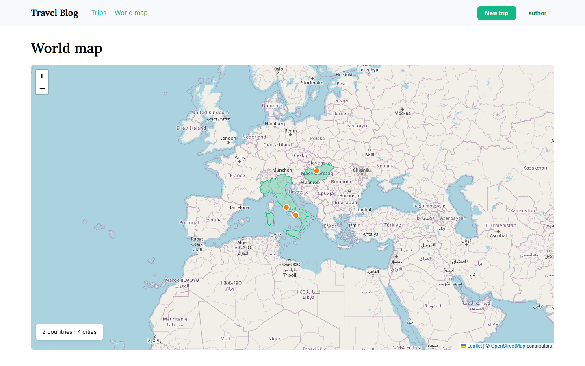
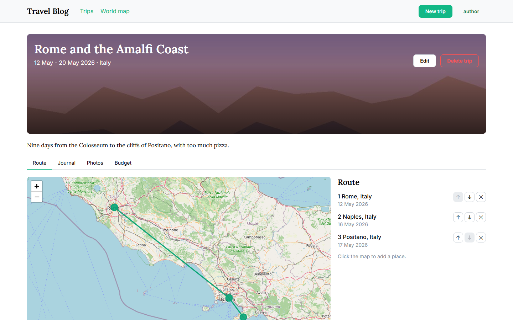
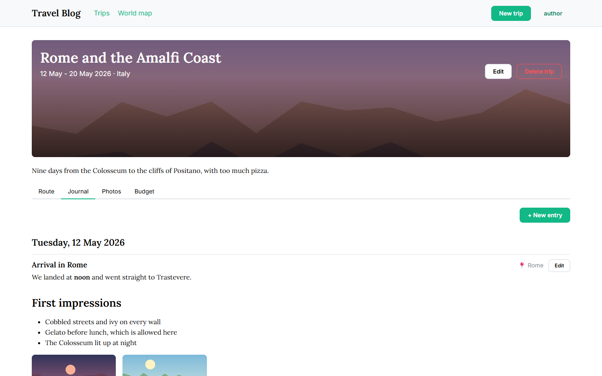
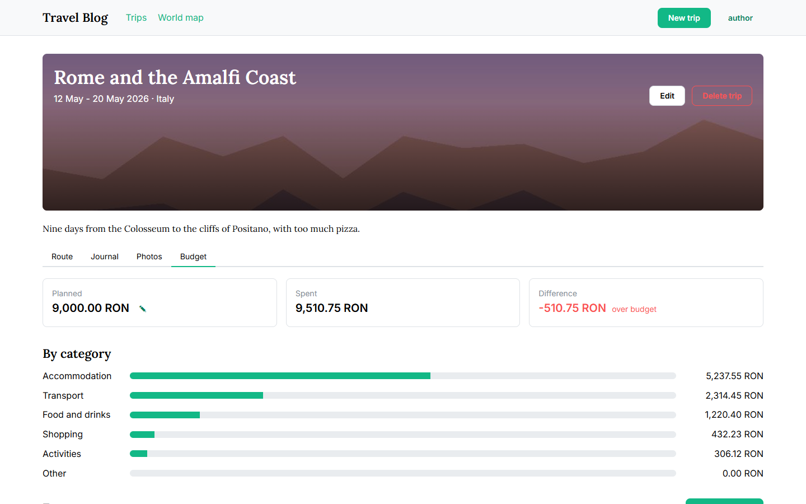

# Travel Blog

[](https://github.com/pivoda-madalina/travelblog/actions/workflows/ci.yml)

A personal travel website where one author records trips, shows every visited place on an interactive world map, writes a day-by-day journal with photos, and tracks trip spending across currencies, converted to RON at National Bank of Romania rates.



## Features

| Feature | What it does |
| --- | --- |
| Trips | Title, dates, summary and cover photo; saved as draft or published |
| Interactive map | A pin for every visited city, visited countries highlighted, and each trip's route |
| Journal and photos | Day-by-day entries in Markdown and a photo gallery for each trip |
| Budget calculator | Expenses in any currency converted to RON, with totals by category and planned versus spent |

Visitors can browse published trips, the map, the journal and photos. Only the author can edit content or see budgets and expenses.

| Trip route | Journal | Budget |
| --- | --- | --- |
|  |  |  |

## Run it

### Prerequisites

- [Git](https://git-scm.com/)
- [Docker Desktop](https://www.docker.com/products/docker-desktop/) (or Docker Engine with Compose v2), started
- GNU Make. It comes with macOS and Linux; on Windows, install it with `winget install ezwinports.make`, or run the `docker compose` commands from the [Makefile](Makefile) yourself.

Nothing else is needed on your machine: Python, Node.js and PostgreSQL run in containers.

### Set up and start

```sh
git clone https://github.com/pivoda-madalina/travelblog.git
cd travelblog
cp .env.example .env
```

Open `.env` and set a password for the demo author:

```sh
SEED_AUTHOR_PASSWORD=choose-a-password
```

Every other value has a working default. Then build and start everything, and load the sample trips:

```sh
make up      # builds the images, starts the database, backend and frontend (about a minute the first time)
make seed    # loads the sample trips and creates the author account
```

Open <http://localhost:5173>. You browse as a visitor; to edit, choose **Sign in** and use username `author` (or your `SEED_AUTHOR_USERNAME`) and the password from `.env`.

### What the sample data shows

| Trip | Shows |
| --- | --- |
| Rome and the Amalfi Coast | Route with three places, Markdown journal with photos, EUR and RON expenses, over its planned budget |
| A long weekend in Budapest | HUF expenses, under its planned budget |
| Lisbon and Porto | A future trip: on its own route map, but not on the world map yet |
| Vienna at Christmas | A draft: only the author can see it |

The photos are drawn placeholders. `make seed` can run again at any time: it replaces the sample trips and leaves any trip you added alone.

### Everyday commands

| Command | What it does |
| --- | --- |
| `make up` | Build and start everything; the site is on <http://localhost:5173> |
| `make down` | Stop everything; the database and uploaded photos are kept |
| `make logs` | Follow the logs of every service |
| `make seed` | Load or reload the sample trips and the author account |
| `make createsuperuser` | Create another account (every signed-in user is the author) |
| `make test` | Run the backend and frontend tests |
| `make lint` | Run Ruff, ESLint, the TypeScript checker and Prettier |

## Tests and linting

`make test` and `make lint` run everything in containers, the same checks as [CI](.github/workflows/ci.yml). Tests never call the network: the exchange-rate feed and the place lookup are mocked.

To run them on your machine instead, install [uv](https://docs.astral.sh/uv/) and Node.js 24, start the database with `docker compose up -d --wait db`, then:

```sh
cd backend
DJANGO_DEBUG=true uv run pytest     # tests with coverage
uv run ruff check . && uv run ruff format --check .

cd ../frontend
npm ci
npm test
npm run lint && npm run typecheck && npm run format:check
```

## Troubleshooting

- **`make up` cannot connect to Docker:** start Docker Desktop and wait until it reports that the engine is running.
- **Port already in use:** the site uses 5173, the API 8000 and the database 5433. The database is published on 5433 rather than 5432 because a local PostgreSQL often holds 5432. To use another port, set `POSTGRES_PORT` in `.env`.
- **`make seed` says to set `SEED_AUTHOR_PASSWORD`:** add it to `.env`, as in [Set up and start](#set-up-and-start).
- **`make seed` says a trip overlaps:** a trip you added shares dates with a sample trip, and trips cannot overlap (BR-10). Change its dates or delete it, then run the seed again.

## How it is built

A Django REST Framework API and a React single-page app in one repository, run together with Docker Compose.

| Layer | Choice |
| --- | --- |
| Backend | Python 3.13, Django 5.2, Django REST Framework, PostgreSQL 17 |
| Frontend | React 19, TypeScript, Vite, TanStack Query, Mantine |
| Map | Leaflet with OpenStreetMap tiles and Natural Earth country shapes |
| External services | National Bank of Romania exchange rates and Nominatim place lookup, both called from the backend only |
| Quality | pytest, Vitest, Ruff, ESLint, Prettier, GitHub Actions, pre-commit |

The backend has one Django app per area (`trips`, `places`, `journal`, `budget`), with shared permissions in `core`. Business rules live in the models, each with a test named after it (`test_br09_...`). The frontend mirrors the areas in `src/features/`.

### Documentation

- [Requirements](docs/requirements.md): scope, user stories and business rules
- [Architecture and engineering guidelines](docs/architecture.md): stack, layout, domain model, conventions and testing
- [UI design](docs/ui-design.md): wireframes for each screen
- [Architecture decision records](docs/adr/):
  [monorepo with Docker Compose](docs/adr/0001-monorepo-with-docker-compose.md),
  [session authentication](docs/adr/0002-session-authentication.md),
  [freezing the exchange rate on each expense](docs/adr/0003-freeze-exchange-rate-on-expense.md),
  [shared cities and trip places](docs/adr/0004-shared-cities-and-trip-places.md),
  [Mantine component library](docs/adr/0005-mantine-component-library.md)
- [Working agreements](CONTRIBUTING.md): issues, branches, commits, pull requests and definition of done
